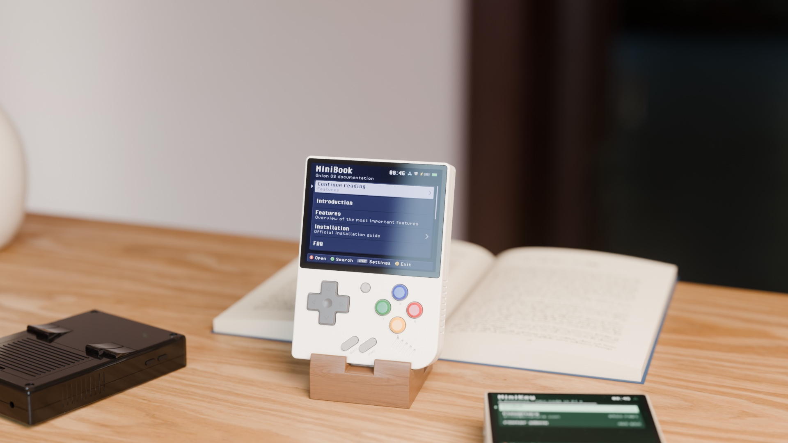
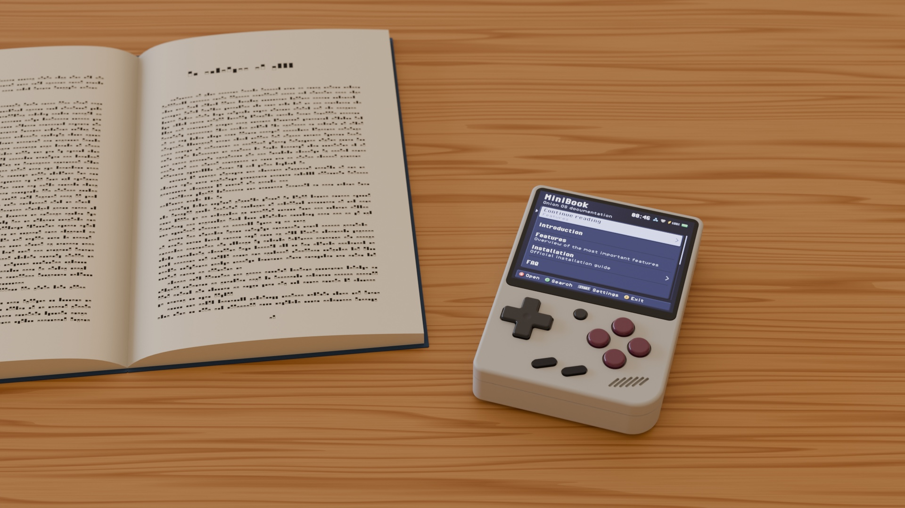

<p align="center"></p>

[](https://github.com/zakijss/MiniBook/actions/workflows/ci.yml)
[](https://github.com/zakijss/MiniBook/releases)
[](LICENSE)

# MiniBook

The [Onion OS documentation](https://github.com/OnionUI/Onion) on the Miyoo Mini Plus itself, readable without Wi-Fi. Part of [MiniDeck](https://github.com/zakijss/MiniDeck).

- Every page you open is saved on the card; **Download all for offline** saves the rest.
- Remembers the page you were reading and your place on each page.
- **X** on a page lists its sections and jumps to one. **L1**/**R1** turn a screenful, **L2**/**R2** jump to the top or bottom of a page or a list.
- **Y** searches page titles, and the text of the saved pages.
- **START** opens Settings: start on the page you were reading, or clear the saved pages.


<p align="center"></p>

## Install

- **MiniMart:** open [MiniMart](https://github.com/zakijss/MiniMart), then **Apps > MiniBook**. It checks the download and keeps your settings on updates.
- **Zip:** download `minibook-VERSION.zip` from [Releases](https://github.com/zakijss/MiniBook/releases/latest), unzip it onto the root of the SD card, and restart.
- **Every MiniDeck app at once:** [minideck-all.zip](https://github.com/zakijss/MiniDeck/releases/latest/download/minideck-all.zip).

## Requirements

A Miyoo Mini Plus on Onion OS 4.4, with Wi-Fi. Other devices and firmwares aren't supported.

## Building

```sh
make check                     # vet, tests, scripts
make package VERSION=1.0.0     # dist/: the release zip, app.json, SHA256SUMS
make deploy HOST=root@miyoo    # build and copy to a device over SSH
```

Go runs in Docker unless you pass `GO=go` (Go 1.27). The interface, themes and networking come from the [MiniDeck library](https://github.com/zakijss/MiniDeck); see its [development notes](https://github.com/zakijss/MiniDeck/blob/main/docs/DEVELOPMENT.md) and [contributing guide](https://github.com/zakijss/MiniDeck/blob/main/CONTRIBUTING.md).

## License

[MIT](LICENSE). Third-party components are listed in [NOTICE](NOTICE). Not made by or affiliated with Miyoo.
